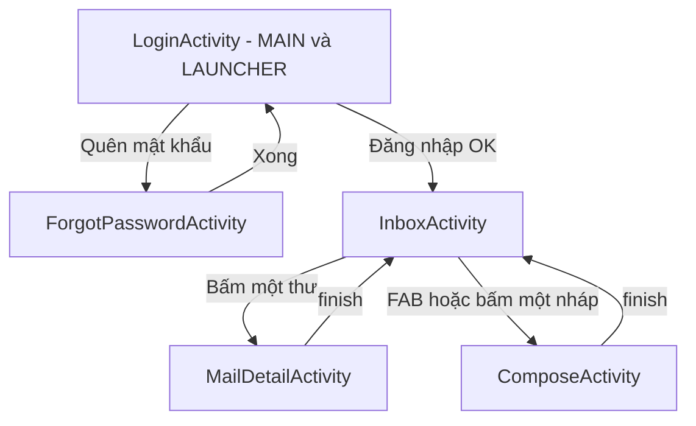
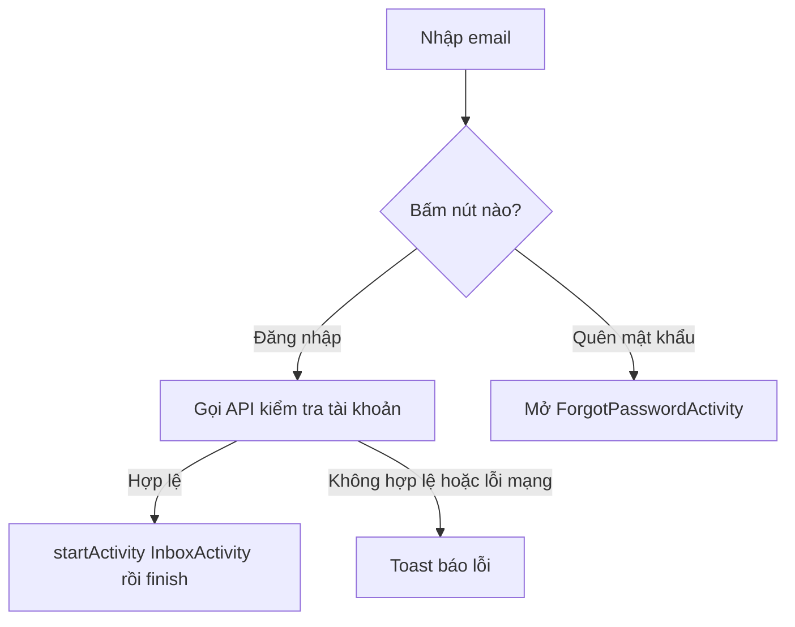
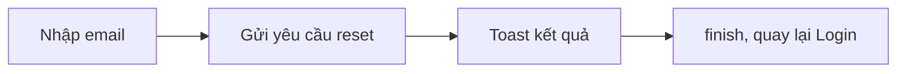
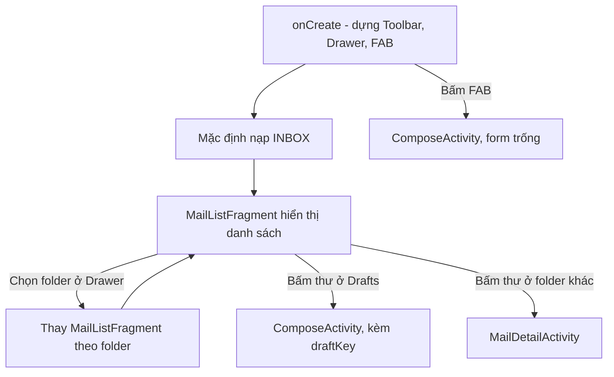
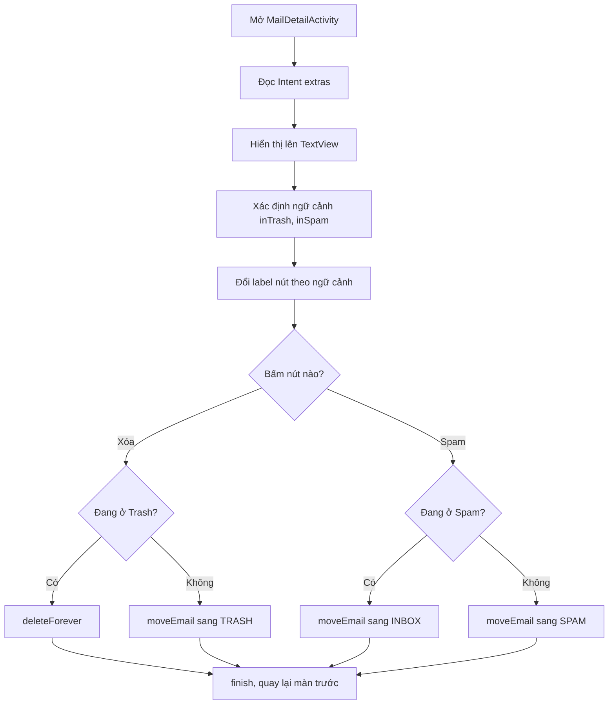
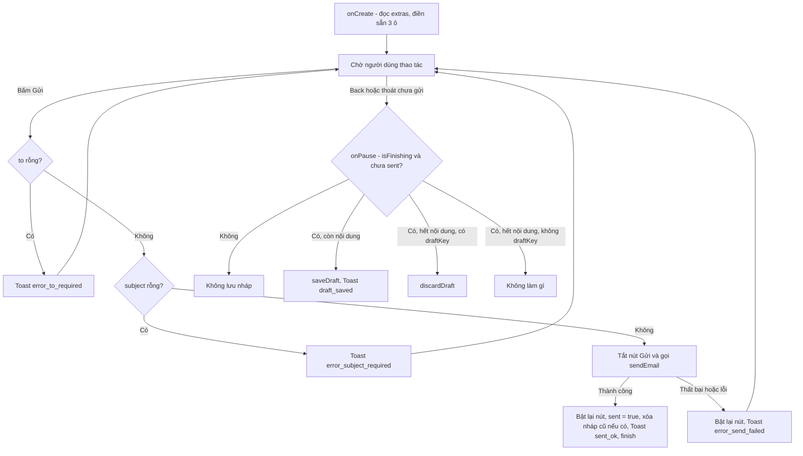
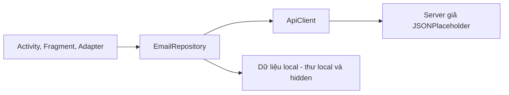

# Email-Client

Ứng dụng **email client trên Android** (Java + XML layouts). Ứng dụng cho phép đăng nhập, xem hộp thư, đọc chi tiết thư, soạn và gửi thư, đồng thời tự động lưu bản nháp

## Tính năng

- **Đăng nhập** bằng địa chỉ email
- **Quên mật khẩu**: màn hình nhập email để nhận hướng dẫn đặt lại (hiện mới là giao diện, chưa kết nối backend)
- **Hộp thư (Inbox)** hiển thị danh sách thư theo từng thư mục
- **Xem chi tiết thư**
- **Soạn và gửi thư** (kiểm tra người nhận và tiêu đề trước khi gửi, chặn bấm gửi nhiều lần)
- **Tự động lưu nháp** khi thoát màn hình soạn thư mà chưa gửi; xóa nháp khi đã gửi hoặc khi nội dung bị xóa hết
- **Quản lý thư**: chuyển vào thùng rác, báo spam / bỏ spam, chuyển về Inbox, xóa vĩnh viễn

## Công nghệ sử dụng

| Thành phần | Công nghệ |
|---|---|
| Ngôn ngữ | Java |
| Giao diện | XML layouts, AppCompat |
| IDE | Android Studio |
| Kiến trúc | Activity / Fragment + Repository + ApiClient |

## Cấu trúc thư mục

```
app/src/main/
├── java/com/example/emailclient/
│   ├── LoginActivity.java           # Đăng nhập
│   ├── ForgotPasswordActivity.java  # Quên mật khẩu
│   ├── InboxActivity.java           # Màn hình chính chứa hộp thư
│   ├── MailListFragment.java        # Danh sách thư
│   ├── MailDetailActivity.java      # Chi tiết thư
│   ├── ComposeActivity.java         # Soạn / gửi thư, lưu nháp
│   ├── EmailAdapter.java            # Adapter cho danh sách thư
│   ├── Email.java                   # Model dữ liệu thư
│   ├── EmailRepository.java         # Lớp truy cập dữ liệu
│   └── ApiClient.java               # Gọi API / xử lý callback
└── res/
    ├── layout/                      # activity_*.xml, fragment_mail_list.xml, item_email.xml
    └── values/                      # strings.xml, colors.xml, themes.xml
```
## Phân tầng

- **`ApiClient`** là cơ chế GET/POST chung, ở tầng **transport** (làm sao gửi)
- **`EmailRepository`** là lớp nghiệp vụ cụ thể, dùng `ApiClient` để thực hiện các thao tác email, ở tầng **domain** (gửi gì, xử lý thế nào)
- **Trước login:** `LoginActivity` : form đăng nhập (có `ForgotPasswordActivity` cho quên mật khẩu)
- **Sau login:** `InboxActivity` : khung chính (Toolbar + Drawer + FAB), từ đây chọn folder và mở màn soạn thư
- **Trong khung:** `MailListFragment` : danh sách thư, được thay theo folder đang chọn
- **Mở thành màn hình riêng (qua Intent):** `ComposeActivity` (soạn thư, mở lại nháp) và `MailDetailActivity` (xem chi tiết thư), được gọi từ FAB hoặc khi bấm một thư trong danh sách

## Khi mở INBOX

1. `InboxActivity` → `MailListFragment.newInstance("INBOX")`
2. Fragment `onResume()` → `EmailRepository.fetchFolder("INBOX", callback)`
3. Repository → `ApiClient.get("/comments?_limit=30")` → JSONPlaceholder trả 30 comment giả (bất đồng bộ, kết quả báo về qua callback)
4. Repository parse JSON → tạo `List<Email>` → lọc `hidden`, chèn thư local lên đầu → báo kết quả về Fragment
5. Fragment tạo `EmailAdapter(list)`, gọi `setFolder("INBOX")`, gắn vào RecyclerView → hiện danh sách thư

`AndroidManifest.xml`
- Khai báo quyền `INTERNET` (bắt buộc để app gọi mạng, tức gửi/nhận thư qua API)
- Đăng ký đủ 5 Activity: `LoginActivity`, `InboxActivity`, `ComposeActivity`, `MailDetailActivity`, `ForgotPasswordActivity` Activity nào thiếu khai báo thì khi mở bằng Intent app sẽ crash
- `LoginActivity` là **màn hình khởi động** (intent-filter `MAIN` + `LAUNCHER`), nên phải đặt `exported="true"`
- `exported="false"` ở 4 màn còn lại: chỉ app này mới mở được, app khác không gọi vào được (bảo mật)
- `windowSoftInputMode="adjustResize"` ở Login, Inbox, Compose: khi bàn phím hiện lên, layout co lại để các ô nhập không bị che

  ## Luồng MailDetailActivity

```text
Mở MailDetailActivity
│
├─ Đọc Intent extras (sender, subject, date, body, folder)
├─ Hiển thị lên TextView
├─ Xác định ngữ cảnh: inTrash / inSpam
├─ Đổi label nút (Xóa → "Xóa vĩnh viễn", Spam → "Không phải spam")
│
├─ Bấm Xóa
│    ├─ Đang ở Trash → deleteForever()
│    └─ Ngược lại    → moveEmail → "TRASH"
│
└─ Bấm Spam
     ├─ Đang ở Spam  → moveEmail → "INBOX"
     └─ Ngược lại    → moveEmail → "SPAM"

Sau mỗi thao tác: finish() → quay lại màn trước
```
## Sơ đồ luồng hoạt động

### 1. Luồng tổng thể của app



**Entry point duy nhất:** `LoginActivity` (intent-filter `MAIN` + `LAUNCHER`).

### 2. LoginActivity: đăng nhập



- `windowSoftInputMode="adjustResize"`: bàn phím không che ô nhập.
- Đăng nhập xong có `finish()`, nên bấm Back không quay lại màn Login.

### 3. ForgotPasswordActivity: quên mật khẩu



### 4. InboxActivity: hộp thư đến



Intent extras khi mở `MailDetailActivity`:

| Key | Giá trị |
| --- | --- |
| `sender` | Địa chỉ người gửi |
| `subject` | Tiêu đề |
| `date` | Ngày gửi |
| `body` | Nội dung |
| `folder` | Tên folder hiện tại (ví dụ Inbox, Trash, Spam) |

### 5. MailDetailActivity: chi tiết email



Hành vi nút theo thư mục:

| Thư mục hiện tại | Nút Xóa | Nút Spam |
| --- | --- | --- |
| Inbox | Chuyển vào Trash | Chuyển vào Spam |
| Trash | Xóa vĩnh viễn (`deleteForever`) | Chuyển vào Spam |
| Spam | Chuyển vào Trash | Chuyển về Inbox ("Không phải spam") |

- Hàm `s(String v)` chống `NullPointerException`: trả `""` nếu `null`.
- `folder.contains("Trash")` / `contains("Spam")` xác định ngữ cảnh linh hoạt, không cần khớp tuyệt đối.

### 6. ComposeActivity: soạn email



- `adjustResize`: bàn phím không che ô Body.
- Cờ `sent` giúp phân biệt "đóng vì đã gửi" và "đóng vì bỏ dở" (chỉ bỏ dở mới lưu nháp).
- Cần quyền `INTERNET` (đã khai báo trong Manifest).

### 7. Tương tác giữa các lớp



### Bảng tóm tắt

| Màn hình | Vào từ | Hành động chính | Ra tới |
| --- | --- | --- | --- |
| `LoginActivity` | Launcher | Đăng nhập, Quên mật khẩu | Inbox / ForgotPassword |
| `ForgotPasswordActivity` | Login | Gửi yêu cầu reset | Quay lại Login |
| `InboxActivity` | Login | Xem danh sách, chọn thư, soạn thư | MailDetail / Compose |
| `MailDetailActivity` | Inbox | Xóa / Spam theo ngữ cảnh | Quay lại Inbox |
| `ComposeActivity` | Inbox | Soạn, gửi, tự lưu nháp | Quay lại Inbox |
